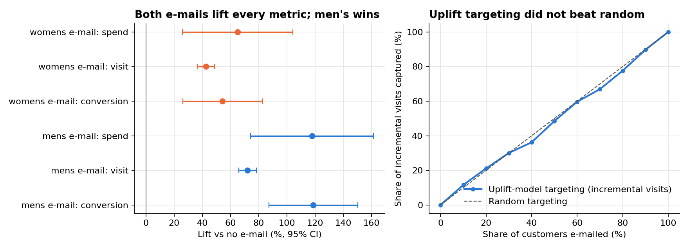

# E-mail Campaign Experiment: A/B/C test analysis and targeting decision

**Question.** Should a retailer send campaign e-mails, which version, and should it target them?

**Data.** A real randomized experiment. In [Kevin Hillstrom's MineThatData challenge](https://blog.minethatdata.com/2008/03/minethatdata-e-mail-analytics-and-data.html), 64,000 recent customers were randomly split into three arms: a men's-merchandise e-mail, a women's-merchandise e-mail, or no e-mail. Visits, purchases and spend were tracked for two weeks.

## Decision memo (TL;DR)

1. **Send the men's e-mail.** Versus no e-mail it more than doubled conversion (0.57% → 1.25%, +0.68 pp, 95% CI [0.50, 0.86]), raised visits by 7.7 pp, and added **$0.77 in spend per customer e-mailed** (bootstrap 95% CI [$0.48, $1.05]). It beat the women's e-mail on every metric.
2. **Don't send the women's e-mail to men's-only buyers.** It raised their visits by just 1.1 pp, vs 7.4 pp for women's buyers (interaction test p < 0.001), and its spend effect for them was not significant.
3. **Don't build uplift targeting for the men's e-mail.** A T-learner uplift model captured incremental visits at the same rate as random targeting on held-out data (top 50% of customers captured 48.5% of incremental visits). The men's e-mail works broadly, so blanket sends are simpler and lose nothing.
4. **Missing guardrail:** the data has no unsubscribe or complaint field. A production rollout should add one before scaling send volume.



## Decisions I owned

- **Fixed the analysis plan before looking at outcomes** (primary metric, comparisons, multiple-testing correction), so the result couldn't be shaped after the fact.
- **Checked the experiment before trusting it**: data-validation SQL, sample-ratio mismatch, covariate balance.
- **Recommended *not* building uplift targeting.** The model worked no better than random targeting on held-out data, so the simpler blanket send wins. Saying no to extra machinery when the evidence doesn't support it is part of the job.
- **Flagged the missing guardrail** (no unsubscribe/complaint data) as a blocker for scaling sends, rather than ignoring it.

## Analysis plan (fixed before looking at outcomes)

| | |
|---|---|
| Primary metric | Conversion (purchase within 2 weeks) |
| Secondary metrics | Visit rate; spend per customer (revenue) |
| Guardrail | Not available in the data (noted as a limitation) |
| Comparisons | 2 treatments × 3 metrics = 6 tests, Holm-corrected at family-wise α = 0.05 |
| Sensitivity (MDE) | With ~21,300 per arm, 80% power at α = 0.05 detects +0.21 pp conversion and +0.84 pp visit rate |

## Checks before trusting any result

| Check | Result |
|---|---|
| SQL data validation (7 rules: nulls, unknown arms, conversion without visit, spend without conversion, ranges) | 0 violations |
| Sample-ratio mismatch (χ² vs equal thirds) | 21,306 / 21,307 / 21,387, p = 0.90, so no SRM |
| Covariate balance (standardized mean differences, 11 covariates × 2 comparisons) | max \|SMD\| = 0.014 |

## Results

| Treatment | Metric | Control | Treated | Lift | 95% CI (abs) | Holm p |
|---|---|---|---|---|---|---|
| Men's | Conversion | 0.57% | 1.25% | +119% | [+0.50, +0.86] pp | < 0.001 |
| Men's | Visit | 10.6% | 18.3% | +72% | [+7.0, +8.3] pp | < 0.001 |
| Men's | Spend / customer | $0.65 | $1.42 | +118% | [$0.49, $1.05] | < 0.001 |
| Women's | Conversion | 0.57% | 0.88% | +54% | [+0.15, +0.47] pp | < 0.001 |
| Women's | Visit | 10.6% | 15.1% | +43% | [+3.9, +5.2] pp | < 0.001 |
| Women's | Spend / customer | $0.65 | $1.08 | +65% | [$0.17, $0.68] | 0.001 |

- **Spend is heavy-tailed and mostly zeros.** I confirmed the Welch interval with a 2,000-draw bootstrap, and they agree.
- **Regression adjustment (CUPED-style)** with pre-period covariates (recency, purchase history, channel, ZIP type) cut standard errors by at most 1.4%. Past behaviour barely predicts two-week response here, so the adjustment isn't worth the added complexity for this campaign. It's a useful thing to check before assuming variance reduction will help.
- **Heterogeneity by past purchases:** the men's e-mail lifts visits in every group, most for customers who bought both categories (+13.4 pp). The women's e-mail depends on audience: +7.4 pp for women's buyers vs +1.1 pp for men's-only buyers.

## How to run

```bash
pip install -r requirements.txt
python analysis.py        # ~10 seconds; writes reports/*.csv and reports/figures/
```

- `sql/validation.sql`: data-quality rules (DuckDB)
- `sql/metrics.sql`: arm-level metric layer (CTEs, `FILTER`, window functions for lift vs control)
- `analysis.py`: SRM, balance, MDE, effects with Holm correction, bootstrap, regression adjustment, interaction tests, T-learner uplift model with held-out evaluation

## Limitations

- The experiment is from 2008 and covers a single two-week window, so there is no long-term or retention effect.
- No guardrail metric is available (unsubscribes, complaints).
- Spend CIs are wide, so segment-level spend conclusions are weaker than visit conclusions.
